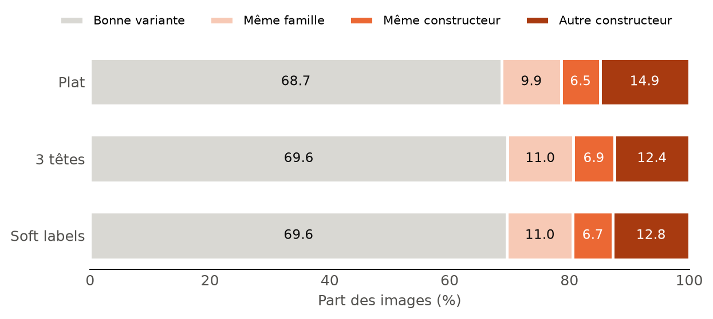
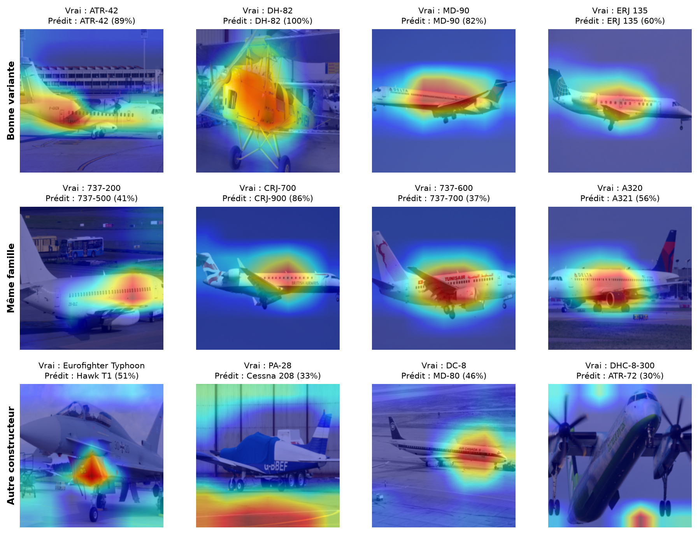
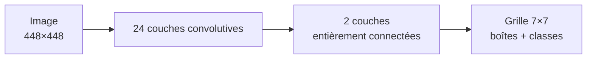
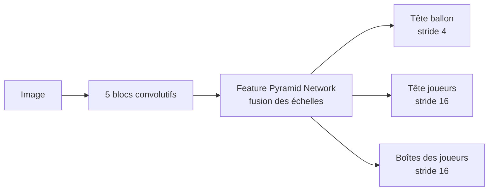

# Deep learning sur les images

Mes 2 projets de deep learning pour mon cours au CNAM (vision par ordinateur, environ 20 h par projet). Tout est fait en PyTorch et entraîné sur un MacBook Air M4.

| | Projet 1 : avions | Projet 2 : foot |
|---|---|---|
| **Le but** | Reconnaître un avion sur une photo | Détecter les joueurs, les arbitres et le ballon |
| **Type de tâche** | Classification | Détection d'objets |
| **Données** | FGVC-Aircraft | Roboflow *football-players-detection* |
| **Modèle** | EfficientNet-B0 | YOLO11 |
| **Où j'en suis** | Terminé | Pas encore commencé |

---

## Projet 1 : reconnaître un avion à 3 niveaux

Le modèle doit trouver le constructeur, la famille et la variante d'un avion (par exemple Boeing > 737 > 737-800). Le dataset a 30 constructeurs, 70 familles et 100 variantes.

**La question de départ :** toutes les erreurs ne se valent pas. Confondre un 737-800 avec un 737-900, ce n'est pas très grave. Le confondre avec un Airbus A320, si. Est-ce qu'on peut faire moins d'erreurs graves en donnant au réseau la hiérarchie des avions ?

**Le résultat :** oui. Le nombre d'erreurs graves baisse de 14 à 16 %, et le modèle ne reconnaît pas moins de variantes pour autant.

Pour tout le détail : [le rapport en PDF](projet1_avions/report/Rapport_projet1_avions.pdf) (6 pages).

### Les 3 modèles comparés

Les 3 modèles utilisent le même réseau (EfficientNet-B0 pré-entraîné sur ImageNet) et les mêmes réglages. Seule la façon de lui donner la hiérarchie change :

- **Plat** (le modèle de référence) : il prédit juste la variante, sans rien savoir de la hiérarchie.
- **3 têtes :** il fait 3 prédictions à partir de la même image (constructeur, famille, variante).
- **Soft labels :** il prédit juste la variante aussi, mais à l'entraînement, une réponse proche de la bonne est moins pénalisée qu'une réponse complètement à côté.

### Les résultats

Sur le test (3 333 images que le modèle n'a jamais vues), en moyenne sur 3 entraînements avec des graines différentes :

| | Plat | 3 têtes | Soft labels |
|---|---|---|---|
| Bonne variante | 68,7 % | 69,6 % | 69,6 % |
| Bonne famille | 79,8 % | 81,8 % | 80,7 % |
| Bon constructeur | 86,4 % | 85,9 % | 87,3 % |
| Erreurs graves (mauvais constructeur) | 14,9 % | 12,4 % | 12,8 % |
| Prédictions cohérentes entre les 3 niveaux | 91,9 % | 83,7 % | 95,4 % |



Ce que j'en retiens :

- **Les erreurs graves baissent vraiment** avec les 2 modèles qui utilisent la hiérarchie (les intervalles de confiance excluent zéro).
- **Le gain sur les variantes est petit** (environ 1 point), donc je ne m'appuie pas dessus.
- **Je ne peux pas départager les 3 têtes et les soft labels** sur les erreurs. J'ai gardé les soft labels pour la démo : c'est plus simple (une seule tête) et le modèle à 3 têtes se contredit sur 16 % des images (par exemple une famille qui n'existe pas chez le constructeur prédit).

Le modèle se trompe surtout sur des avions très proches, comme le C-47 et le DC-3 (le C-47 est la version militaire du DC-3).

### Où le modèle regarde

Grad-CAM montre les zones de l'image qui ont le plus compté dans la prédiction. Sur ces images tirées au hasard, le modèle regarde en général l'avion, mais pour plusieurs erreurs graves il regarde le sol. Ça reste une observation sur 12 images, pas une preuve.



### Tester la démo

Le modèle est déjà dans le repo, pas besoin de télécharger le dataset ni de réentraîner. Il faut Python 3.12.

```bash
git clone https://github.com/titouanfleurent-png/deep-learning-images.git
cd deep-learning-images
python3.12 -m venv .venv && source .venv/bin/activate
pip install -r requirements.txt
cd projet1_avions && python app.py
```

Ensuite, ouvre http://127.0.0.1:7860 et mets une photo d'avion. Je n'ai pas mesuré les performances sur des photos hors du dataset : les scores au-dessus ne valent que pour ce type de photos.

### Refaire les entraînements

Il faut 2,75 Go pour le téléchargement. Compte environ 40 min par entraînement sur un MacBook Air M4, sachant qu'il y en a 9. Depuis `projet1_avions/`, avec l'environnement activé :

```bash
./scripts/download_data.sh
./scripts/run_all.sh
python -m src.evaluate --split val
python -m src.analyze --split val
```

Pour un seul modèle : `python -m src.train --model soft --seed 0`.

J'ai utilisé le split test une seule fois, après avoir figé mes choix sur la validation ([le protocole](projet1_avions/results/protocole_fige.md)). Pour rester propre, garde le test pour la toute fin si tu changes quelque chose.

### Les limites

- J'ai testé une seule architecture et une seule résolution (224 px). Les différences entre variantes sont parfois trop fines à cette taille.
- Je n'ai pas optimisé les poids de la hiérarchie dans les fonctions de perte.
- 3 graines, c'est peu pour mesurer précisément la variabilité entre entraînements.

### Les articles

- **Maji et al. (2013)**, *Fine-Grained Visual Classification of Aircraft* ([arXiv](https://arxiv.org/abs/1306.5151)) : l'article du dataset.
- **Bertinetto et al. (2020)**, *Making Better Mistakes* ([arXiv](https://arxiv.org/abs/1912.09393)) : l'idée de juger un modèle sur la gravité de ses erreurs, et les soft labels.

---

## Projet 2 : détecter les joueurs, les arbitres et le ballon

Pas encore commencé. Le but est de détecter les joueurs, les arbitres et le ballon sur des images de match en plan large. Le plus dur, c'est le ballon, qui ne fait que quelques pixels.

Ce que je prévois de tester avec YOLO11 (pré-entraîné sur COCO) :

- une résolution de 640 ou de 1280 px ;
- un modèle plus ou moins gros (n ou s) ;
- le découpage de l'image en morceaux (SAHI) pour mieux trouver le ballon.

### Les articles

**Redmon et al. (2016)**, *You Only Look Once* ([arXiv](https://arxiv.org/abs/1506.02640)) : le réseau regarde l'image une seule fois et prédit directement les boîtes et les classes.



**Komorowski et al. (2020)**, *FootAndBall* ([arXiv](https://arxiv.org/abs/1912.05445)) : un détecteur fait pour le foot, avec une partie dédiée au ballon qui travaille sur une carte plus fine.



---

## L'organisation du repo

```text
.
├── requirements.txt
└── projet1_avions/
    ├── app.py        # la démo
    ├── models/       # le modèle de la démo et les noms des classes
    ├── notebooks/    # exploration, préparation, résultats
    ├── report/       # le rapport en PDF
    ├── results/      # scores, figures, protocole
    ├── scripts/      # téléchargement des données, entraînements
    └── src/          # dataset, modèle, entraînement, évaluation
```

## Les données et les droits

Les photos de FGVC-Aircraft appartiennent à leurs photographes et sont mises à disposition **uniquement pour de la recherche non commerciale** ([la page du dataset](https://www.robots.ox.ac.uk/~vgg/data/fgvc-aircraft/)). Elles ne sont pas dans ce repo, à part celles visibles dans les notebooks et les figures, et le même cadre vaut pour le modèle entraîné dessus.
