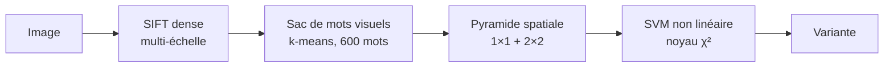
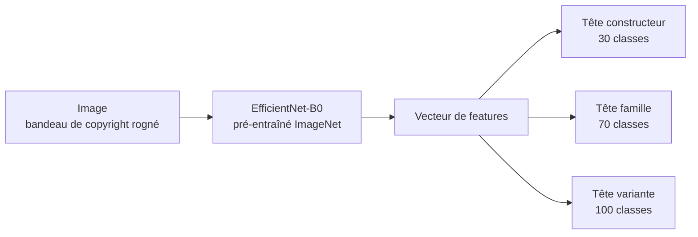
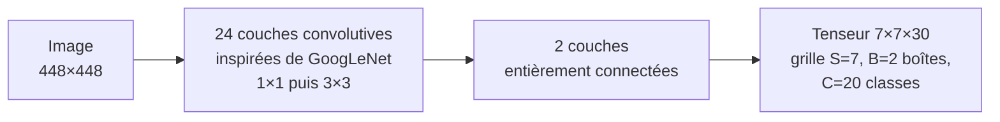
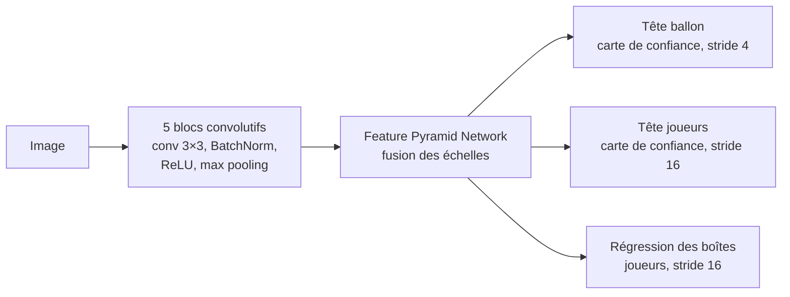

# Deep learning appliqué aux images

Deux projets de vision par ordinateur réalisés dans le cadre d'un cours de deep learning (CNAM). Ils sont développés en PyTorch et entraînés sur un MacBook Air M4, via le GPU Apple (MPS).

| | Projet 1 : avions | Projet 2 : football |
|---|---|---|
| **Tâche** | Classification fine et hiérarchique | Détection d'objets |
| **Question** | Un CNN qui exploite la hiérarchie des classes fait-il des erreurs moins graves ? | Pourquoi le ballon est-il si dur à détecter, et comment l'améliorer ? |
| **Données** | FGVC-Aircraft | Roboflow *football-players-detection* |
| **Modèle** | EfficientNet-B0 pré-entraîné, 3 têtes de classification | YOLO11 pré-entraîné sur COCO |
| **Statut** | En cours | À venir |

---

## ✈️ Projet 1 : reconnaissance d'avions en hiérarchie

L'objectif est de reconnaître le modèle d'un avion sur une photo, à trois niveaux : **constructeur** (30 classes), **famille** (70) et **variante** (100). Exemple : *Boeing > 737 > 737-800*.

### Article de référence

**Maji, S., Rahtu, E., Kannala, J., Blaschko, M., & Vedaldi, A. (2013). *Fine-Grained Visual Classification of Aircraft*.**
📄 [arXiv:1306.5151](https://arxiv.org/abs/1306.5151)

- **Contribution** : le dataset FGVC-Aircraft. Il contient 10 000 photos d'avions, annotées sur 3 niveaux hiérarchiques, avec 3 splits égaux (train, val, test).
- **Difficulté** : les différences entre variantes sont minuscules (hublots, winglets, moteurs), alors que la livrée des compagnies varie énormément d'une photo à l'autre.

**Architecture utilisée dans l'article** (baseline antérieure au deep learning) :



### Approche de ce projet

Les features fabriquées à la main (SIFT) sont remplacées par un **CNN pré-entraîné**, qui apprend lui-même ses features. Ce CNN est surmonté d'une tête par niveau de la hiérarchie.



- **Perte** : somme pondérée des cross-entropies des 3 têtes.
- **Comparaison** : un modèle plat (une seule tête à 100 variantes) face au modèle hiérarchique.
- **Évaluation** : accuracy par niveau, gravité des erreurs (distance dans la hiérarchie), cohérence des prédictions entre niveaux, Grad-CAM.

---

## ⚽ Projet 2 : détection des joueurs, arbitres et ballon

L'objectif est de détecter et reconnaître les **joueurs**, les **arbitres** et le **ballon** sur des images de match filmées en plan large. Le ballon, qui ne fait que quelques pixels, est au centre du projet.

### Articles de référence

**Redmon, J., Divvala, S., Girshick, R., & Farhadi, A. (2016). *You Only Look Once: Unified, Real-Time Object Detection*. CVPR 2016.**
📄 [arXiv:1506.02640](https://arxiv.org/abs/1506.02640)

- **Contribution** : la détection devient une seule régression. L'image est découpée en grille, et chaque cellule prédit des boîtes, un score de confiance et des probabilités de classe, en une seule passe du réseau.
- **Limite reconnue par les auteurs** : les petits objets, surtout lorsqu'ils sont groupés.

**Architecture utilisée dans l'article** :



Une variante allégée, **Fast YOLO**, n'utilise que 9 couches convolutives.

**Komorowski, J., Kurzejamski, G., & Sarwas, G. (2020). *FootAndBall: Integrated Player and Ball Detector*. VISAPP 2020.**
📄 [arXiv:1912.05445](https://arxiv.org/abs/1912.05445)

- **Contribution** : un détecteur joueurs et ballon conçu pour les vidéos de foot haute résolution en plan large.
- **Idée clé** : combiner plusieurs échelles de features (Feature Pyramid Network) pour ne pas perdre le ballon, avec une tête dédiée au ballon sur une carte de features fine.
- **Résultat** : meilleur que Faster R-CNN sur le ballon, en temps réel, avec environ 199 000 paramètres seulement.

**Architecture utilisée dans l'article** :



### Approche de ce projet

- **Modèle** : fine-tuning de **YOLO11** (Ultralytics), pré-entraîné sur COCO, sur 3 classes : joueur (gardiens inclus), arbitre, ballon.
- **Expériences** : résolution d'entrée 640 contre 1280 px, taille du modèle (n contre s), inférence par tuiles (SAHI) pour le ballon.
- **Évaluation** : mAP@50 et mAP@50-95 par classe, analyse des erreurs selon la taille des objets.

---

## Environnement

- Python 3.12 et PyTorch, avec le backend MPS (GPU Apple)
- `timm`, `torchvision`, `ultralytics`, `scikit-learn`, `grad-cam`, `gradio`

```bash
python3.12 -m venv .venv && source .venv/bin/activate
pip install torch torchvision timm ultralytics supervision scikit-learn opencv-python grad-cam gradio matplotlib pandas tensorboard
python check_env.py
```

## Structure

```text
.
├── check_env.py          # vérification de l'environnement (bibliothèques + GPU MPS)
├── projet1_avions/
│   ├── data/             # FGVC-Aircraft (non versionné)
│   ├── notebooks/        # exploration, visualisations
│   ├── src/              # dataset, modèle, entraînement, évaluation
│   ├── configs/
│   └── runs/             # logs d'entraînement (non versionnés)
└── projet2_foot/         # à venir
```
